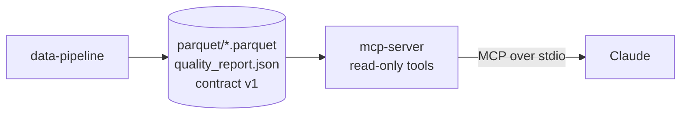

# mcp-server

A read-only MCP server that gives Claude tools over data-pipeline's published outputs.



## Key numbers

| What | Number | How to check |
|---|---|---|
| Tests | 40, all offline on the copied samples, in about 1 second | `uv run pytest -q` |
| Tools | 1, `metrics_freshness` | `grep -c "@server.tool" src/mcp_server/metrics.py` |
| Copied files | 6: five sample files and the contract doc, from data-pipeline's `contract-v1` tag at commit `1823391` | `tests/samples/v1/SOURCE.json`, and `make sync-samples` prints the count |
| Size of a `metrics_freshness` result | 271 characters, for a live pipeline run | Count the result shown in the quickstart |

This is the scaffold: the shared machinery and one tool. The tool list and a real exchange
with Claude will be added here as the tools are built.

## Quickstart

Needs [uv](https://docs.astral.sh/uv/). It installs Python 3.14 and the locked dependencies.

```sh
make install
make check
```

The server reads outputs that [data-pipeline](https://github.com/yasabbasi/data-pipeline)
published. Its demo writes a set to `data/demo/output/`, offline:

```sh
cd ../data-pipeline
make demo
```

Register the server with Claude Code. `<dir>` is the full path of the output directory and
`<repo>` is the full path of this repo:

```sh
claude mcp add tools --env DATA_OUTPUT_DIR=<dir> -- uv run --directory <repo> mcp-server
```

Then ask Claude how fresh the metrics are. Over stdio, `metrics_freshness` returned this for
the outputs of a live pipeline run against BigQuery:

```json
{
  "run_id": "41a81830d9dc495abb3d153e017c78af",
  "source": "bigquery",
  "contract_version": "v1",
  "generated_at": "2026-11-16T14:00:35Z",
  "data_min_date": "2019-01-02",
  "data_max_date": "2026-11-15",
  "restated_from": "2026-11-02",
  "quality_status": "pass"
}
```

The demo outputs give the same shape with `"source": "fixtures"`.

## How it works

- **Outputs:** each tool call reads `$DATA_OUTPUT_DIR/parquet/<table>.parquet` with a fresh
  in-memory DuckDB. The server never writes, and there is no default directory: if the
  variable is unset or a file is missing, the tool says what to set.
- **Contract:** [docs/contract.md](docs/contract.md) is a copy of data-pipeline's contract v1.
  Every tool starts by loading the run. Outputs with another contract version, or with metric
  names that differ from the contract's, are refused with a message that says what to do.
- **Tools:** each tool is one function in its group's module, such as
  [src/mcp_server/metrics.py](src/mcp_server/metrics.py). It is named `<group>_<noun>`, marked
  read-only, and returns a typed result. `metrics_freshness` returns the run id, source,
  contract version, data range, publish time and quality status.
- **SQL:** queries are built only from constants in this repo. Tool arguments and values read
  from the data are bound as parameters and never become SQL text.
- **Errors:** an error Claude can act on is a `ToolError` with a message that says what to
  do. The text of any other error stays in the server's log.
- **Transport:** stdio. stdout carries the protocol, so the server logs to stderr.
- **Samples:** the tests read [tests/samples/v1/](tests/samples/v1/), copied from
  data-pipeline's `contract-v1` tag. `SOURCE.json` records the commit and a SHA-256 for each
  file. A test checks the files against it, and CI compares them with the tag itself.

## Limitations

- **One tool.** Only `metrics_freshness` exists so far. It does not return metric values.
- **One contract version.** The server reads contract v1 and refuses anything else.
- **Local only.** It runs as a subprocess of the client over stdio. There is no HTTP
  transport and no authentication.
- **Parquet only.** It reads the Parquet files. It does not read `metrics.duckdb`, and no
  tool reads `quality_report.json` yet.
- **No cache.** Every call reads the files again, so it always sees the latest published run.

## Development

- `make check` runs the linters and the tests. CI runs the same command, then compares the
  copied samples with data-pipeline's contract tags, which needs the network.
- `make format` fixes style and formatting.
- `make sync-samples` copies a contract version's samples and contract doc from the tag in a
  local clone: `make sync-samples PIPELINE=../data-pipeline VERSION=v1`. Never edit the copies.
- To add a tool, add a function to its group's module and tests in `tests/test_<group>.py`.
  `tests/test_server.py` holds the rules every tool must meet. A new group is a new module
  named in `GROUPS` in [src/mcp_server/cli.py](src/mcp_server/cli.py).

## License

MIT, see [LICENSE](LICENSE).
