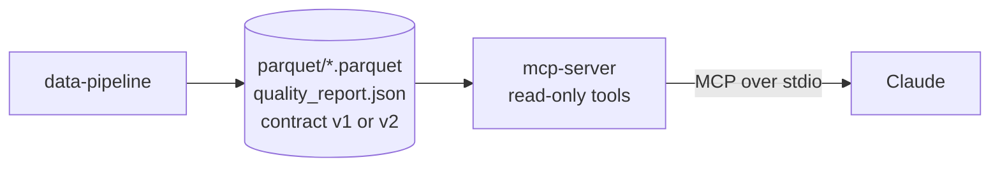

# mcp-server

A read-only MCP server that gives Claude tools over data-pipeline's published outputs.



## Key numbers

| What | Number | How to check |
|---|---|---|
| Tests | 294, all offline on the copied samples of v1 and v2, in about 6 seconds | `uv run pytest -q` |
| Tools | 6, all in the `metrics` group | `grep -c "@server.tool" src/mcp_server/metrics.py` |
| Copied files | 13: five v1 sample files from data-pipeline's `contract-v1` tag at commit `1823391`, and seven v2 sample files and the contract doc from its `contract-v2` tag at commit `dc875dd` | `tests/samples/v*/SOURCE.json`, and `make sync-samples` prints the count |
| Size of a `metrics_freshness` result | 271 characters, for a live pipeline run | Count the result shown in the quickstart |

The six tools, each on outputs of contract v1 or v2:

- `metrics_breakdown`: one metric split by category or distribution center over a date range;
  any metric on v2, only the additive ones and `return_rate` on v1.
- `metrics_daily_totals`: the published totals of a date range by day, week or month.
- `metrics_explain`: the full definition of one metric.
- `metrics_freshness`: the run the metrics come from, its data range and its quality status.
- `metrics_list`: every metric with its label, unit and whether it is additive.
- `metrics_quality_report`: the run's quality status, row counts and checks that did not pass.

## Quickstart

Needs [uv](https://docs.astral.sh/uv/). It installs Python 3.14 and the locked dependencies.

```sh
make install
make check
```

The server reads outputs that [data-pipeline](https://github.com/yasabbasi/data-pipeline)
published. Its demo writes a set to `data/demo/output/`, offline; its README says how to run it.

Register the server with Claude Code. `<dir>` is the full path of the output directory and
`<repo>` is the full path of this repo:

```sh
claude mcp add tools --env DATA_OUTPUT_DIR=<dir> -- uv run --directory <repo> mcp-server
```

Then ask Claude how fresh the metrics are. Over stdio, `metrics_freshness` returned this for
the outputs of a live pipeline run against BigQuery:

```json
{
  "run_id": "41a81830d9dc495abb3d153e017c78af",
  "source": "bigquery",
  "contract_version": "v1",
  "generated_at": "2026-11-16T14:00:35Z",
  "data_min_date": "2019-01-02",
  "data_max_date": "2026-11-15",
  "restated_from": "2026-11-02",
  "quality_status": "pass"
}
```

The demo outputs give the same shape with `"source": "fixtures"`.

## How it works

- **Outputs:** each tool call reads `$DATA_OUTPUT_DIR/parquet/<table>.parquet` with a fresh
  in-memory DuckDB. The server never writes, and there is no default directory: if the
  variable is unset or a file is missing, the tool says what to set.
- **Contract:** [docs/contract.md](docs/contract.md) is a copy of data-pipeline's contract v2.
  The server reads v1 and v2. Every tool starts by loading the run. Outputs with another
  contract version, or with metric
  names that differ from the contract's, are refused with a message that says what to do.
- **Tools:** each tool is one function in its group's module, such as
  [src/mcp_server/metrics.py](src/mcp_server/metrics.py). It is named `<group>_<noun>`, marked
  read-only, and returns a typed result. Ratios are fractions between 0 and 1, rounded to four
  places in SQL; money is rounded to two places and counts are integers.
  - `metrics_breakdown` splits a metric by category or distribution center, largest slice
    first, at most 50 slices. On v2 it reads `daily_by_category` or
    `daily_by_distribution_center` and splits every metric, and says whether the slices add up
    and whether the value is approximate. On v1 it splits only `revenue`, `units`,
    `returned_units` or `return_rate`.
  - `metrics_daily_totals` returns the totals by day, week or month in columns, at most 2,000
    values, and marks the periods that may still change.
  - `metrics_explain` returns one metric's description, aggregation and formula.
  - `metrics_freshness` returns the run id, source, contract version, data range, publish time
    and quality status.
  - `metrics_list` returns every metric's name, label, unit and whether it is additive.
  - `metrics_quality_report` returns the run's status, the rows each source table gave and
    at most 50 checks that did not pass.
- **SQL:** queries are built only from constants in this repo. Tool arguments and values read
  from the data are bound as parameters and never become SQL text.
- **Errors:** an error Claude can act on is a `ToolError` with a message that says what to
  do. The text of any other error stays in the server's log.
- **Transport:** stdio. stdout carries the protocol, so the server logs to stderr.
- **Samples:** every test runs on [tests/samples/v1/](tests/samples/v1/) and
  [tests/samples/v2/](tests/samples/v2/), copied from data-pipeline's `contract-v1` and
  `contract-v2` tags. `SOURCE.json` records the commit and a SHA-256 for each
  file. A test checks the files against it, and CI compares them with the tag itself.

## Limitations

- **One tool group.** The six tools are all in `metrics`. On v1 outputs only `revenue`,
  `units`, `returned_units` and `return_rate` can be split by category or distribution center.
- **Two contract versions.** The server reads contract v1 and v2 and refuses anything else.
- **Local only.** It runs as a subprocess of the client over stdio. There is no HTTP
  transport and no authentication.
- **No database file.** It reads the Parquet files and `quality_report.json`. It does not read
  `metrics.duckdb`.
- **No cache.** Every call reads the files again, so it always sees the latest published run.

## Development

- `make check` runs the linters and the tests. CI runs the same command, then compares the
  copied samples with data-pipeline's contract tags, which needs the network.
- `make format` fixes style and formatting.
- `make sync-samples` copies a contract version's samples and contract doc from the tag in a
  local clone: `make sync-samples PIPELINE=../data-pipeline VERSION=v1`. Never edit the copies.
- To add a tool, add a function to its group's module and tests in `tests/test_<group>.py`.
  `tests/test_server.py` holds the rules every tool must meet. A new group is a new module
  named in `GROUPS` in [src/mcp_server/cli.py](src/mcp_server/cli.py).

## License

MIT, see [LICENSE](LICENSE).
